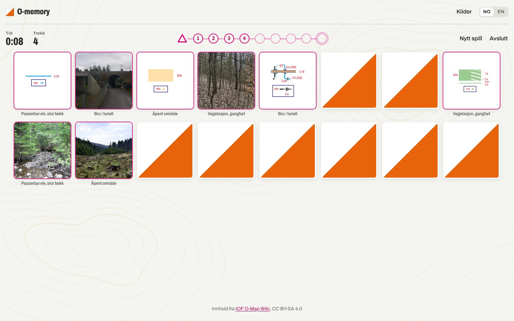
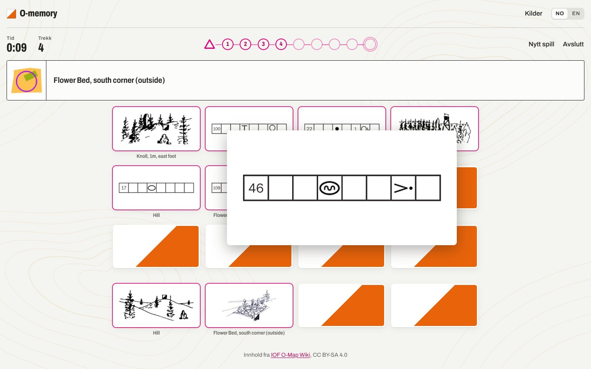
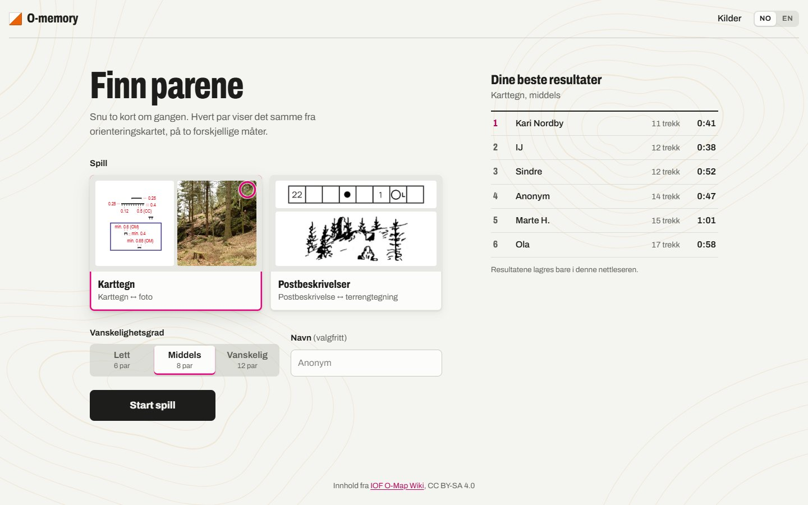

# O-memory

[](https://github.com/sotpoteten/o-memory/actions/workflows/ci.yml)

Et memory-spill for orienteringsløpere. Hvert par består av to bilder av det samme, og det finnes to spillmoduser:

- **Karttegn:** et ISOM-karttegn og et foto av terrengobjektet i virkeligheten.
- **Postbeskrivelser:** en IOF-postbeskrivelse og en tegning av posten i terrenget. Når paret er funnet, vises
  kartutsnittet og tekstbeskrivelsen.

**Spill på nett: https://sotpoteten.github.io/o-memory/**





## Funksjoner

- Tre vanskelighetsgrader: 6, 8 eller 12 par.
- Trekk og tid telles, og resultatet lagres automatisk i en highscore-liste per modus og vanskelighetsgrad.
  På nettversjonen lagres listen bare i nettleseren din.
- Åpne kort forstørres og legges kant i kant, så detaljene er lette å se.
- Ferdig brett kan gås gjennom etterpå, med zoom på hvert kort.
- Norsk og engelsk språkversjon. Første gang følges nettleserens språk.
- Lett forvekslbare karttegn (for eksempel de ulike steintegnene) kommer aldri i samme spill.
- Brettet tilpasses vinduet, så hele spillet er synlig uten scrolling på PC.



## Teknologi

| Del | Teknologi | Mappe |
| --- | --- | --- |
| Frontend | React 19 + Vite + TypeScript | `web` |
| API | ASP.NET Core Minimal API + EF Core SQLite (.NET 10) | `src/Mem.Api` |
| Scraper | .NET-konsollapp + AngleSharp (nedlasting via curl) | `tools/OmapScraper` |
| PDF-uttrekk | .NET-konsollapp + PdfPig og PDFtoImage | `tools/ControlDescriptionExtractor` |

Spillogikken er en ren reducer (`web/src/game/memoryGame.ts`), og plasseringen av kortene regnes ut av rene
funksjoner (`zoomLayout.ts`, `boardFit.ts`). Alt dette er dekket av enhetstester.

## Kom i gang

Krever .NET 10 SDK og Node 20.19 eller nyere. Bilder og data ligger allerede i `data/`.

```sh
# 1. Start API-et (http://localhost:5126)
dotnet run --project src/Mem.Api --launch-profile http

# 2. Start frontend (http://localhost:5173, proxyer /api og /images til API-et)
cd web && npm install && npm run dev
```

## Statisk versjon (GitHub Pages)

Nettversjonen kjører uten API. Frontend leser datafilene i `data/` direkte og setter sammen spillene selv
(`web/src/static/`), og highscore lagres i nettleserens localStorage. Hvilken variant som bygges, avgjøres
ved byggetid med `--mode pages`.

```sh
cd web
npm run dev:pages       # http://localhost:5173/o-memory/, uten API
npm run build:pages     # web/dist med datafilene kopiert inn
```

Hver push til `main` bygger og publiserer siden med `.github/workflows/pages.yml`.

## Tester

```sh
dotnet test          # parsere, spilloppsett, API og data
cd web && npm test   # spillogikk og layout (Vitest)
```

## API

- `GET /api/game?pairs=6|8|12&mode=symbols|descriptions` – kortstokk med to kort per par, ustokket
- `GET /api/highscores?pairs=8&mode=symbols` – topp 10 for modusen og vanskelighetsgraden
- `POST /api/highscores` – `{ name, pairs, moves, timeMs, mode }`
- `GET /api/symbols` – alle karttegn med foto og kreditering

`mode` er valgfri og er `symbols` hvis den utelates.

## Produksjon

Kjør `cd web && npm run build`, kopier `web/dist` til `src/Mem.Api/wwwroot`, og publiser API-et.
API-et serverer da også frontend. Sett `DataDirectory` og `ConnectionStrings:Mem` for miljøet.

## Generere data på nytt

Dette trengs bare hvis kildene endres. Resultatet skrives til `data/`.

```sh
# Karttegn og foto fra O-Map Wiki (HTML caches i tools/OmapScraper/.cache)
dotnet run --project tools/OmapScraper            # valgfritt: -- --max-photos 4 --limit 10

# Postbeskrivelser fra side 18–29 i «International Specification for Control Descriptions 2024»
dotnet run --project tools/ControlDescriptionExtractor -- "<sti til PDF-en>" [--contact-sheet oversikt.html]
```

- **Scraperen** henter bare kategori 1–5. Tekniske symboler (6xx) og løypesymboler (7xx) har ikke noe foto.
- **PDF-uttrekket** finner tabellrutenettet på hver side og klipper ut kart, terrengtegning og postbeskrivelse
  uendret, bare beskåret.
- **Forvekslingsgrupper** ligger i `data/confusable-groups.json` (vedlikeholdes for hånd) og
  `data/control-descriptions-groups.json` (lages av PDF-uttrekket og overskrives når det kjøres).
- **Norske karttegnnavn** ligger i `data/i18n/symbols.nb.json`. Flere språk legges til som
  `symbols.<språk>.json`. Mangler et navn, brukes det engelske.

## Lisenser

Kildekoden er lisensiert under [MIT](LICENSE). Innholdet kommer fra andre og har egne lisenser:

| Innhold | Kilde | Lisens |
| --- | --- | --- |
| Karttegn, definisjoner og foto (`data/images`, `data/symbols.json`, `tests/OmapScraper.Tests/Fixtures`) | © IOF og bidragsytere til [IOF O-Map Wiki](https://omapwiki.orienteering.sport/) | [CC BY-SA 4.0](https://creativecommons.org/licenses/by-sa/4.0/) |
| Postbeskrivelser, terrengtegninger og kartutsnitt (`data/control-descriptions`, `data/control-descriptions.json`) | © IOF, [International Specification for Control Descriptions 2024](https://orienteering.sport/iof/rules/control-descriptions/) | [CC BY-ND 4.0](https://creativecommons.org/licenses/by-nd/4.0/), gjengitt uendret bortsett fra beskjæring |
| Norske karttegnnavn (`data/i18n/symbols.nb.json`) | Norges Orienteringsforbunds oversettelse av ISOM 2017 | Kreditert. 203.2, 513.2 og 532 er oversatt manuelt |

Fotograf og kilde for hvert bilde vises på «Kilder»-siden i spillet.

## Om utviklingen

Prosjektet er utviklet av Isak Jonsson med [Claude Code](https://claude.com/claude-code) som programmeringsassistent.
